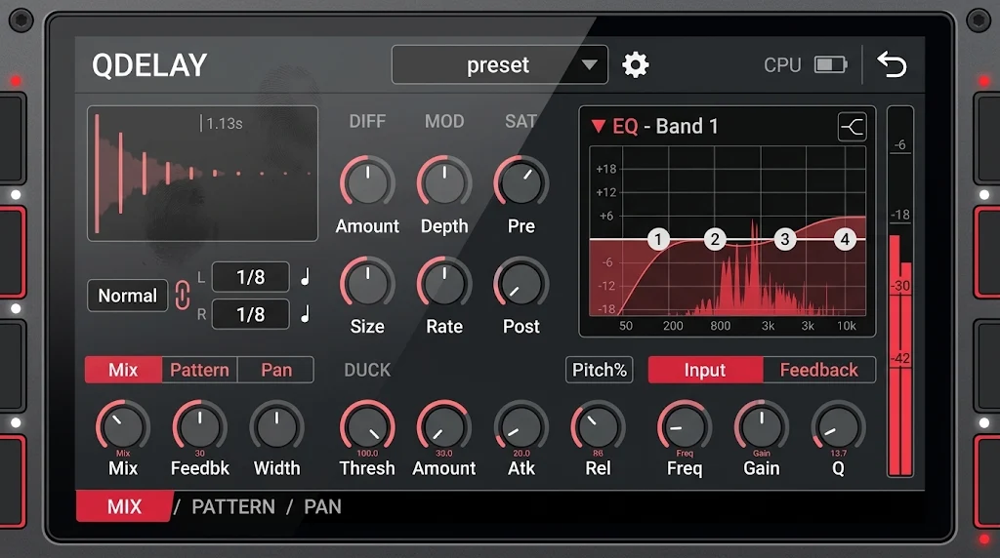

# QDelay Auto Clear

A dual stereo delay with a musical **Auto Clear** function: when a new note
arrives, the old delay tail fades out smoothly, the delay line is cleared, and
the wet signal fades back in. The new note's own first repeat survives.

This repository is a fork of [QDelay](https://github.com/tiagolr/qdelay) by
Tilr, extended with:

- the Auto Clear note-fade behaviour
- a reworked, MPC-ready DSP path
- nine Dub presets
- a native **Akai MPC standalone** VST2 build (ARM64 and ARM32)
- an ARM64 Linux desktop build with the full JUCE editor



## Auto Clear

Auto Clear is inspired by the AIR Delay Pro "Auto Clear" idea, but it does not
hard-cut the tail:

1. a new note is detected from the audio input (or MIDI, when available)
2. the wet path fades out quickly
3. the delay line is cleared at minimum gain, keeping the last few milliseconds
   so the new note's attack remains
4. after the hold time the wet path fades back in over the Clear Fade time

The old repeats disappear, the new note keeps its first repeat, and the reset
cannot click. Controls: **Auto Clear**, **Fade**, **Threshold**, **Hold**,
**Amount** and **Source** (Audio / MIDI / both).

## Features

- Stereo dual delay with independent left/right times
- Tempo sync with straight, triplet and dotted divisions
- Normal, Ping-Pong and Classic Ping-Pong routing
- Feedback width, stereo width, swing and feel
- 12 dB/oct low/high cut, parametric feedback EQ and a DC blocker
- Diffusion with a true allpass chain
- Modulation and tape wow/flutter
- 2x oversampled feedback saturation
- Input ducking
- Freeze with a click-free crossfade
- Smooth, click-free parameter changes
- Output limiter and feedback clamp
- Auto Clear with audio or MIDI triggering

## Presets

The factory bank contains **Init**, **Classic Pong** and nine Dub presets:

| Preset | Character |
|---|---|
| Dub Chamber | long ping-pong, filtered repeats, diffusion and tape |
| Tubby's Tape | 1/4-note tape echo, wow and flutter |
| Thunder Dub | 1/2-dotted twin taps, dark tail, Auto Clear 70 ms |
| Dub Siren | fast modulation and saturation for siren throws |
| Melodica Echo | triplet 1/8, bright and short |
| Spring Dub | high diffusion, spring-like smeared repeats |
| Dub Plate | saturated, band-limited, tape-worn dub plate |
| Auto Clear Throw | 1/4 send with a 12 ms Auto Clear and 40 ms hold |
| Dub Clean | open, clean 1/4 dub echo without drive |

## Akai MPC

MPC OS 3.10.1+ loads third-party VST2 plugins from a `VST2 Plugins` folder at
the root of a drive. MPC has no plugin windows and no X11/font stack, so the MPC
build is a separate headless VST2 using Akai's MIT-licensed MPC Plugin SDK. Its
touch UI and 16 Q-Link mappings are generated from `mpc/ui.json`.

Build and package:

```bash
./scripts/build-mpc.sh
```

Output:

```
dist/mpc/Tilr - VST - QDelay/
├── plugin.json
├── version.xml
├── VST/qdelay-arm64.so     # MPC Live III / XL and 64-bit MPC OS
├── VST/qdelay-arm32.so     # Live / Live II / One / One+ / X / Key / Force
└── Plugin Skins/           # TUI.json, Q-Links.json, artwork
```

Install:

1. Copy the whole `Tilr - VST - QDelay` folder to
   `<drive>/VST2 Plugins/`.
2. On the MPC open **Preferences → Enhancements (Beta)** and enable
   **Enable Enhancements** and **External Plugin Support**.
3. Restart or rescan. QDelay appears under **External Plugins** as an insert
   effect.

If the MPC is connected as a USB drive, `./scripts/install-mpc.sh` mounts the
drive, replaces the installed copy, syncs and unmounts it again.

The MPC build is a VST2 shared library with only `libc` and `libm` as
dependencies. It exports `VSTPluginMain` and uses the clean-room VST2 ABI from
the MPC SDK.

## ARM64 Linux desktop

The JUCE editor build (the one shown in `sketch.png`) can be cross-compiled for
64-bit ARM Linux:

```bash
./scripts/build-juce-aarch64.sh
# dist/juce-linux-aarch64/QDelay-vst2-aarch64.so
```

Copy the resulting `.so` to `~/.vst/` on the ARM64 machine. This build is for a
desktop DAW; it is not the MPC build.

## Build from source

Prerequisites: CMake 3.22+, a C++20 compiler, JUCE 8.0.12 as the `libs/JUCE`
submodule, and a local VST 2.4 SDK for the VST2 wrapper.

```bash
git clone --recurse-submodules git@github.com:coolvegan/qdelay-autoclear.git
cd qdelay-autoclear

# VST2 headers are not redistributable; fetch them locally
./scripts/fetch-vst2-sdk.sh

# Native Linux VST2 + Standalone
cmake -S . -B build -DCMAKE_BUILD_TYPE=Release \
  -DBUILD_VST2=ON -DBUILD_VST3=OFF -DBUILD_LV2=OFF
cmake --build build -j"$(nproc)"
```

Build everything that this fork adds:

```bash
./scripts/build-all.sh
```

This builds the JUCE ARM64 VST2, the MPC ARM64/ARM32 package, runs the MPC host
simulator and validates the package.

The VST2 SDK is intentionally not committed. The MPC build does not need it; it
uses the MIT-licensed clean-room ABI in `mpc/framework/mpc_vst2_abi.h`.

## Verification

The MPC build is tested with the SDK's MPC-compatible host simulator before it
is packaged:

- ARM64 and ARM32: 20/20 host checks pass
- Auto Clear: old tail suppressed to about -90 dB, new first repeat preserved
- maximum feedback/drive/diffusion: no NaN, no clipping, no denormals
- output limiter holds peaks at or below 0 dBFS
- MPC validator: 0 errors, 0 warnings
- ARM64 and ARM32 binaries also execute and pass under QEMU with an ARM sysroot

## Signal path

```
input -> low/high cut -> diffusion -> dual delay
      -> feedback EQ -> saturation -> tone -> feedback gain
      -> Auto Clear / ducking -> stereo width -> dry/wet -> limiter -> output
```

## Project layout

| Path | Contents |
|---|---|
| `src/` | JUCE plugin, editor and DSP |
| `resources/presets/` | factory preset XML |
| `mpc/src/QDelayMpc.cpp` | MPC / VST2 DSP and entry point |
| `mpc/ui.json` | MPC touch UI layout |
| `mpc/framework/` | vendored MIT MPC Plugin SDK framework |
| `mpc/tools/` | MPC host simulator, skin generator, validator |
| `scripts/` | build, VST2 SDK fetch and MPC install scripts |
| `docker/` | cross-compilation images |
| `cmake/toolchains/` | ARM64 Linux toolchain |

## Credits

QDelay was created by **Tilr** and is based on ideas from EchoBoy, ReplikaXT,
Deelay, Saike's pitch shifter, JClones TapeHead and ChowDSP's AnalogTapeModel.
See the upstream project for the original DSP history and implementation
notes: <https://github.com/tiagolr/qdelay>.

The MPC build uses the MIT-licensed MPC Plugin SDK framework by inMusic.

## License

QDelay is distributed under the **GNU General Public License v3.0**; see
[`LICENSE`](LICENSE). JUCE is used under the AGPLv3 or a commercial JUCE
license. The MPC Plugin SDK framework is MIT licensed; its license is included
in `mpc/vendor/MPC-PLUGIN-SDK-LICENSE`.
